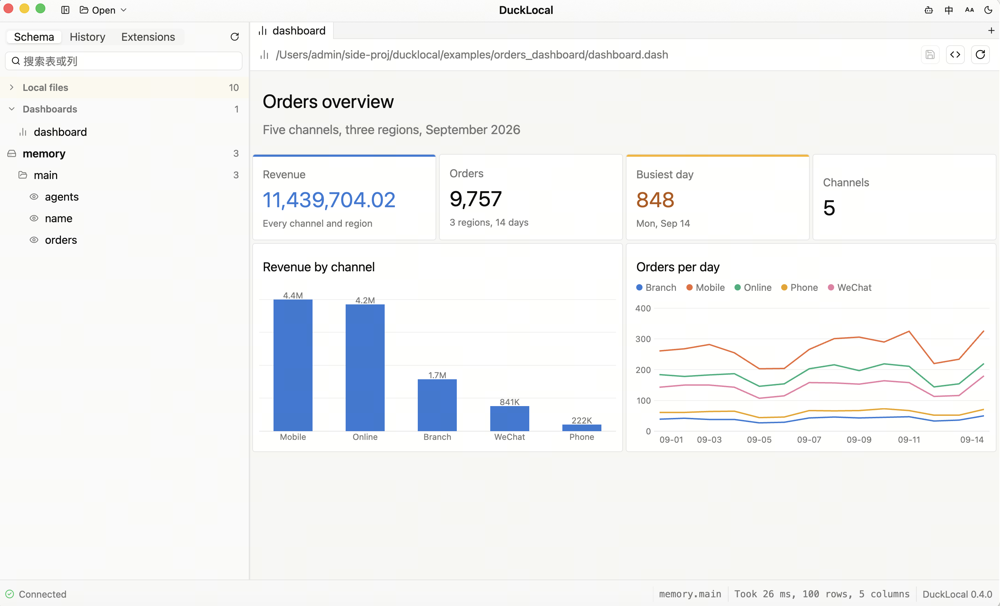
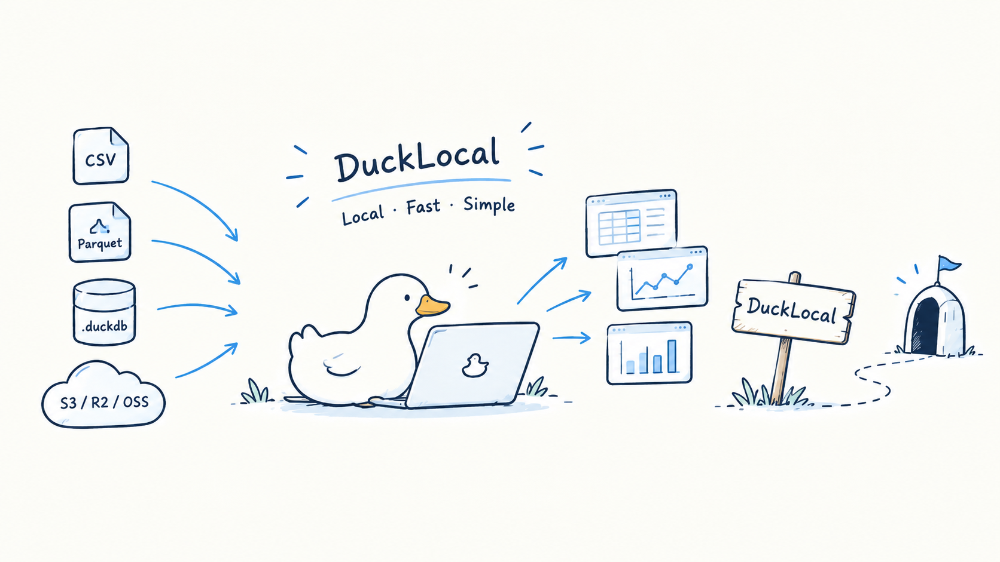

<div align="center">


# DuckLocal

**Point it at your files. Get answers in SQL.**

A fast, native desktop workspace for CSV, Parquet, JSON, Excel and DuckDB files.<br>
No connections to set up, no schema to create, nothing uploaded.

[](https://github.com/JetSquirrel/DuckLocal/releases/latest)
[](LICENSE)


**[Download](#download)** · **[ducklocal.app](https://ducklocal.app/)** · **[Docs](https://ducklocal.app/docs/)** · **[中文文档](README.zh-CN.md)**



</div>

## Why DuckLocal

- **Zero setup.** Open a file, a folder or a glob, and every table in it can be queried at once.
- **Private by default.** Your data never leaves your machine. There's no account and no telemetry.
- **Native and fast.** It's a Rust app built on GPUI with DuckDB inside, not a browser tab.
- **From a query to a dashboard.** You can turn results into charts, and save dashboards as plain-text `.dash` files that live next to your data.
- **Agents can use it too.** The same binary runs headless and returns JSON, so AI agents can explore data and hand results back to your window.

## Download

| Platform | Package |
| --- | --- |
| macOS 12+ (Apple silicon) | [ducklocal-macos-arm64.dmg](https://github.com/JetSquirrel/DuckLocal/releases/latest/download/ducklocal-macos-arm64.dmg) (signed and notarized) |
| Windows x86_64 | [ducklocal-windows-x86_64.zip](https://github.com/JetSquirrel/DuckLocal/releases/latest/download/ducklocal-windows-x86_64.zip) |
| Linux x86_64 | [ducklocal-linux-x86_64.tar.gz](https://github.com/JetSquirrel/DuckLocal/releases/latest/download/ducklocal-linux-x86_64.tar.gz) |

All releases are on the [releases page](https://github.com/JetSquirrel/DuckLocal/releases).

## Open your data

```bash
ducklocal ./logs/             # every data file under a folder, recursively
ducklocal ./billing.parquet   # one file
ducklocal './data/*.csv'      # a pattern
ducklocal warehouse.duckdb    # or an existing DuckDB database
```

You can also drag files onto the window or pick them from the file dialog. DuckLocal remembers the workspace for the next launch.

To try the dashboard in the screenshot above, run this from a checkout of the repository:

```bash
ducklocal examples/orders_dashboard/dashboard.dash
```

## Features

<table>
<tr>
<td width="50%" valign="top">

### ⌨️ SQL editor
- Syntax highlighting, autocompletion and formatting
- Multiple tabs; run with `Cmd+Enter` / `Ctrl+Enter`
- `EXPLAIN` for the query plan, and a profiler (`EXPLAIN ANALYZE`) that shows where time goes

</td>
<td width="50%" valign="top">

### 🔍 Data exploration
- Schema sidebar: browse tables and columns, generate a `SELECT`, change column types
- Results grid with filtering, copying, CSV/Parquet export and built-in charts
- An Overview tab with per-column statistics: nulls, distinct values, range and distribution
- Query history

</td>
</tr>
<tr>
<td valign="top">

### 📊 Dashboards
- Line, bar, stacked bar, area, scatter, pie, heatmap, histogram, map and timeline charts
- Tables, metric cards with notes and tones, and text panels
- Interactive cross-filtering
- Number formats for money, percentages and fixed decimal places (`"usd"`, `"pct1"`, `"num2"`)

</td>
<td valign="top">

### 🧩 DuckDB inside
- Attach other DuckDB or SQLite databases next to the ones you have open
- Install, load and update extensions from the Extensions tab, including community ones such as `mssql` (SQL Server)
- S3 support through httpfs (credentials last only for the session)
- When a database file won't open, DuckDB explains why: the file needs a newer version, uses an old format, or is SQLite

</td>
</tr>
<tr>
<td valign="top">

### 🍎 At home on macOS
- Double-click Parquet and DuckDB files in Finder to open them
- Quick Look previews for Parquet, DuckDB, CSV, TSV and JSON Lines

</td>
<td valign="top">

### 🎨 Comfortable to use
- Light and dark themes
- Four interface sizes
- English and 简体中文

</td>
</tr>
</table>

## Built for AI agents

The same binary runs headless and returns structured JSON, so an AI agent can explore data without opening a window, then show you the result in the window:

```bash
ducklocal schema ./data/                                  # what can be queried, with columns
ducklocal query --sql "SELECT * FROM 'sales.csv'" --limit 20
ducklocal check dashboard.dash                            # validate a dashboard spec
ducklocal propose dashboard.dash --from new.dash          # suggest a change for a person to review
ducklocal session show                                    # how an analysis got here, and what no longer holds
ducklocal open --run --sql "SELECT ..."                   # hand a result to the running window
ducklocal open --state                                    # read back what the window shows
ducklocal project check                                   # will this analysis folder work here, and if not, why
```

- **[A worked investigation](examples/cloudtrail_investigation/README.md)** follows a made-up CloudTrail incident from the first query to a reviewed dashboard.
- **[The official agent skill](skills/ducklocal/SKILL.md)** teaches an agent to read the schema first, then run SQL analysis and convert files. Copy it into your project:

  ```bash
  mkdir -p /path/to/your-project/.claude/skills
  cp -R skills/ducklocal /path/to/your-project/.claude/skills/
  ```

- **Safe defaults.** Database files open read-only unless you pass `--read-write`. Run SQL you didn't write yourself with `query --restricted --allow-read PATH`, and check a dashboard you didn't write with `check --restricted --allow-read PATH`. In restricted mode, DuckDB refuses access to other files, the network, extensions and writes. It is not an OS sandbox; see [what it does and doesn't limit](docs/agent-security.md).

The [CLI guide](https://ducklocal.app/docs/cli) covers every command and option. The [handoff contract](docs/agent-handoff.md) explains how an agent stays in step with the window.

## Privacy



Your data stays on your machine. DuckLocal goes online only for these optional features:

- The OpenStreetMap base map for map charts (View → Online base map, off by default)
- The update check, which downloads a newer release from dl.ducklocal.app and installs it on restart (click the version in the status bar, or turn on DuckLocal → Check for Updates at Launch, off by default)
- S3, when you configure it
- Extensions you install
- SQL that names a remote address

There is no telemetry. [Network and privacy](docs/network-and-privacy.md) lists every network path and how to verify it.

## Documentation

Guides, a tutorial and troubleshooting are at **[ducklocal.app/docs](https://ducklocal.app/docs/)** (source: [JetSquirrel/ducklocal-site](https://github.com/JetSquirrel/ducklocal-site)).

## Development

```bash
cargo run                     # start with an empty workspace
cargo run -- ./data/logs/     # or open something straight away
./scripts/bundle.sh           # build target/release/DuckLocal.app (unsigned)
```

Release builds target macOS 12+ on Apple silicon, Linux x86_64 and Windows x86_64. `scripts/package-macos.sh` builds the signed, notarized dmg. See [development](https://ducklocal.app/docs/development).

<details>
<summary><b>Windows notes</b></summary>

```powershell
cargo build --release --locked
python scripts/check-windows.py target/release/ducklocal.exe
```

The executable opens the GUI without a console window, and Explorer and the taskbar show its embedded duck icon. CLI commands attach to the caller's console and keep redirected stdin/stdout/stderr and LSP pipes working. In PowerShell, use `Start-Process -Wait -PassThru` when you need to wait for an exit code, or a pipeline to capture JSON, for example `./ducklocal.exe query --sql "SELECT 42" | Out-String`.

For a smaller binary, build with `cargo build --profile compact --locked` (output: `target/compact/ducklocal.exe`). This optimizes the Rust code for size while DuckDB's C++ engine keeps optimization level 3; both profiles keep LTO and symbol stripping. The normal release build stays optimized for speed, so compare actual size and performance on the target machine.

To regenerate the committed Windows icon, run `python scripts/make-icons.py --windows` (requires Pillow). Normal builds need neither Python nor Pillow. MSVC builds need the Visual Studio C++ tools and the Windows SDK. Run `cargo test --release perf_g_ -- --nocapture --test-threads=1` to compare category-chart allocations, and `perf_h_` to compare long-text column fitting.

</details>

## License

[Apache-2.0](LICENSE) · Copyright © 2026 JetSquirrel
