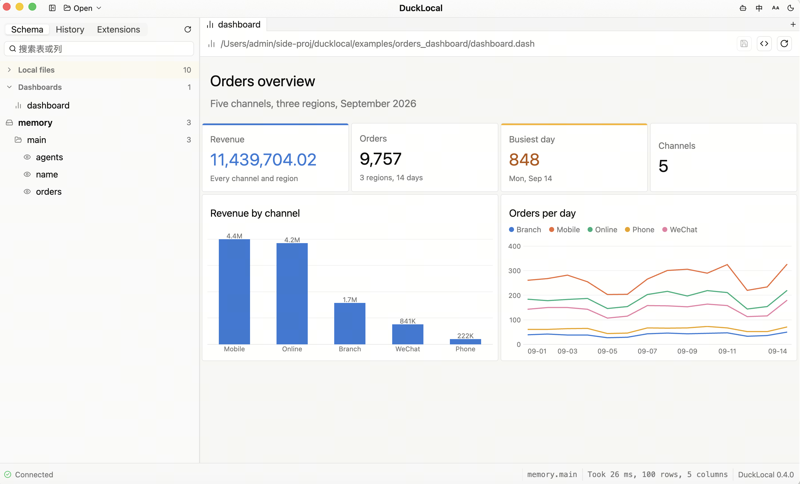
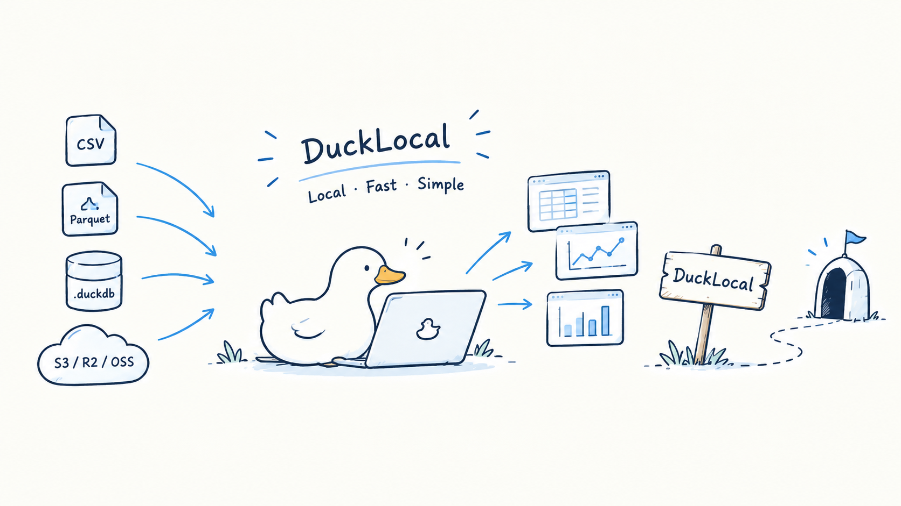

<div align="center">


# DuckLocal

**指向你的文件，用 SQL 拿到答案。**

快速的原生桌面数据工作台，直接查询 CSV、Parquet、JSON、Excel 和 DuckDB 文件。<br>
不用配置连接，不用建 schema，也不会上传任何数据。

[](https://github.com/JetSquirrel/DuckLocal/releases/latest)
[](LICENSE)


**[下载](#下载)** · **[ducklocal.app](https://ducklocal.app/zh/)** · **[文档](https://ducklocal.app/docs/zh/)** · **[English](README.md)**



</div>

## 为什么用 DuckLocal

- **打开就能查**：打开一个文件、文件夹或通配符，里面的每张表都能直接查询。
- **数据不出本机**：数据只留在你的电脑上，不需要账号，也没有遥测。
- **原生且快**：用 Rust 写成，界面基于 GPUI，内置 DuckDB，不是套了壳的浏览器页面。
- **从查询到 Dashboard**：查询结果可以直接画图，Dashboard 存成纯文本的 `.dash` 文件，和数据放在一起。
- **Agent 也能用**：同一个二进制可以无窗口运行并输出 JSON，AI agent 能自己探索数据，再把结果交回你的窗口。

## 下载

| 平台 | 安装包 |
| --- | --- |
| macOS 12+（Apple 芯片） | [ducklocal-macos-arm64.dmg](https://github.com/JetSquirrel/DuckLocal/releases/latest/download/ducklocal-macos-arm64.dmg)（已签名并公证） |
| Windows x86_64 | [ducklocal-windows-x86_64.zip](https://github.com/JetSquirrel/DuckLocal/releases/latest/download/ducklocal-windows-x86_64.zip) |
| Linux x86_64 | [ducklocal-linux-x86_64.tar.gz](https://github.com/JetSquirrel/DuckLocal/releases/latest/download/ducklocal-linux-x86_64.tar.gz) |

所有版本见 [Releases 页面](https://github.com/JetSquirrel/DuckLocal/releases)。

## 打开数据

```bash
ducklocal ./logs/             # 递归打开文件夹下的所有数据文件
ducklocal ./billing.parquet   # 单个文件
ducklocal './data/*.csv'      # 通配符
ducklocal warehouse.duckdb    # 或已有的 DuckDB 数据库
```

也可以把文件拖进窗口，或者用文件对话框选择。工作区会被记住，下次启动直接恢复。

想看上面截图里的 Dashboard，在仓库目录里运行：

```bash
ducklocal examples/orders_dashboard/dashboard.dash
```

## 功能

<table>
<tr>
<td width="50%" valign="top">

### ⌨️ SQL 编辑器
- 语法高亮、自动补全、格式化
- 多 Tab，`Cmd+Enter` / `Ctrl+Enter` 运行
- 用 `EXPLAIN` 查看执行计划，用“性能分析”（`EXPLAIN ANALYZE`）找出耗时的算子

</td>
<td width="50%" valign="top">

### 🔍 数据探索
- Schema 侧栏：浏览表和列、一键生成 `SELECT`、修改列类型
- 结果表格：筛选、复制、导出 CSV/Parquet、内置图表
- “概览”标签页：每一列的空值、不同值、范围和分布
- 查询历史

</td>
</tr>
<tr>
<td valign="top">

### 📊 Dashboard
- 折线、柱状、堆叠柱状、面积、散点、饼图、热力图、直方图、地图、时间线
- 表格、带注释和色调的指标卡、文字面板
- 交叉筛选
- 数字可按金额、百分比或固定小数位显示（`"usd"`、`"pct1"`、`"num2"`）

</td>
<td valign="top">

### 🧩 内置 DuckDB
- 在已打开的数据库旁附加更多 DuckDB 或 SQLite 数据库
- 在扩展标签页安装、加载和更新扩展，包括 `mssql`（SQL Server）等社区扩展
- 通过 httpfs 支持 S3（凭据只在当前会话有效）
- 数据库文件打不开时会说明原因：需要更新版本的 DuckDB、存储格式过旧，或者文件其实是 SQLite

</td>
</tr>
<tr>
<td valign="top">

### 🍎 融入 macOS
- 在访达里双击 Parquet 和 DuckDB 文件即可打开
- 按空格用快速查看（Quick Look）预览 Parquet、DuckDB、CSV、TSV 和 JSON Lines

</td>
<td valign="top">

### 🎨 用着顺手
- 明暗主题
- 四档界面大小
- 中英文界面

</td>
</tr>
</table>

## 为 AI Agent 而建

同一个二进制可以无窗口运行并输出结构化 JSON。AI agent 不用打开界面就能探索数据，再把结果显示到你的窗口里：

```bash
ducklocal schema ./data/                                  # 列出可查询的内容及列
ducklocal query --sql "SELECT * FROM 'sales.csv'" --limit 20
ducklocal check dashboard.dash                            # 校验 dashboard 文件
ducklocal propose dashboard.dash --from new.dash          # 提出修改，交给人审阅
ducklocal session show                                    # 分析是怎么走到这一步的，哪些结论已经不成立
ducklocal open --run --sql "SELECT ..."                   # 把结果交给正在运行的窗口
ducklocal open --state                                    # 读取窗口当前显示的内容
ducklocal project check                                   # 这个分析文件夹能不能在这里用，不能的话原因是什么
```

- **[完整排查示例](examples/cloudtrail_investigation/README.md)**（英文）：从第一条查询到审阅过的 Dashboard，走完一次虚构的 CloudTrail 安全事件。
- **[官方 agent skill](skills/ducklocal/SKILL.md)**：教 AI 先查 schema，再做 SQL 分析和格式转换。复制到你的项目即可：

  ```bash
  mkdir -p /path/to/your-project/.claude/skills
  cp -R skills/ducklocal /path/to/your-project/.claude/skills/
  ```

- **默认安全**：数据库文件默认只读，写入要加 `--read-write`。不是你自己写的 SQL，用 `query --restricted --allow-read PATH` 运行；不是你自己写的 Dashboard，用 `check --restricted --allow-read PATH` 校验。受限模式下，DuckDB 会拒绝访问其他文件、网络、扩展，也不允许写入。它不是操作系统级别的沙箱，具体限制见[它管什么、不管什么](docs/agent-security.md)（英文）。

全部命令和参数见 [CLI 指南](https://ducklocal.app/docs/zh/cli)。agent 怎样和窗口保持同步，见[交接约定](docs/agent-handoff.md)（英文）。

## 隐私



数据只留在你的电脑上。DuckLocal 只在用到以下可选功能时才会联网：

- 地图图表的 OpenStreetMap 底图（「视图 → 在线底图」，默认关闭）
- 检查更新：有新版本时从 dl.ducklocal.app 下载，重启后安装（点击状态栏里的版本号，或打开「DuckLocal → 启动时检查更新」，默认关闭）
- 你主动配置的 S3
- 你安装的扩展
- SQL 里写明的远程地址

没有任何遥测。[Network and privacy](docs/network-and-privacy.md)（英文）列出了所有联网途径和验证方法。

## 文档

使用指南、上手教程和问题排查见 **[ducklocal.app/docs](https://ducklocal.app/docs/zh/)**（源码：[JetSquirrel/ducklocal-site](https://github.com/JetSquirrel/ducklocal-site)）。

## 开发

```bash
cargo run                     # 启动空工作区
cargo run -- ./data/logs/     # 或直接打开数据
./scripts/bundle.sh           # 生成 target/release/DuckLocal.app（未签名）
```

发布构建支持 macOS 12+（Apple 芯片）、Linux x86_64 和 Windows x86_64；`scripts/package-macos.sh` 生成签名并公证的 dmg。详见[开发文档](https://ducklocal.app/docs/zh/development)。

<details>
<summary><b>Windows 说明</b></summary>

```powershell
cargo build --release --locked
python scripts/check-windows.py target/release/ducklocal.exe
```

生成的 `target/release/ducklocal.exe` 双击打开 GUI 时不会弹出控制台窗口，资源管理器和任务栏显示内嵌的鸭子图标。CLI 命令会连接调用方的控制台，重定向的 stdin/stdout/stderr 和 LSP 管道照常可用。在 PowerShell 里需要等待命令结束或拿到退出码时，用 `Start-Process -Wait -PassThru`；要捕获 JSON 就用管道，例如 `./ducklocal.exe query --sql "SELECT 42" | Out-String`。

想要更小的可执行文件，可以用 `cargo build --profile compact --locked` 构建，输出在 `target/compact/ducklocal.exe`。这个配置让 Rust 代码按体积优化，DuckDB 的 C++ 引擎仍用 `opt-level=3`；两种配置都保留 LTO 和符号剥离。默认 release 构建仍以速度优先，实际大小和速度请在目标机器上比较。

重新生成仓库里的 Windows 图标：安装 Pillow 后运行 `python scripts/make-icons.py --windows`。正常构建不需要 Python 或 Pillow；MSVC 构建需要 Visual Studio C++ 工具和 Windows SDK。

性能探针：`cargo test --release perf_g_ -- --nocapture --test-threads=1` 比较分类图表的内存分配，`perf_h_` 比较长文本的列宽自适应；输出包含基线和优化后的耗时、分配次数和字节数。

</details>

## 开源协议

[Apache-2.0](LICENSE) · Copyright © 2026 JetSquirrel
